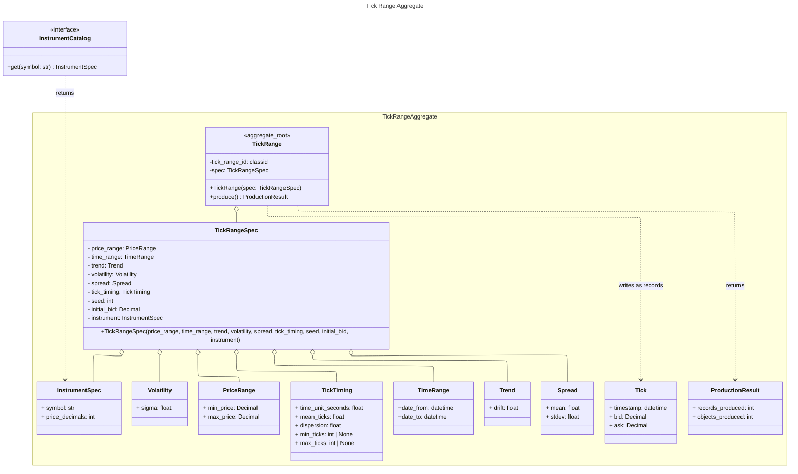
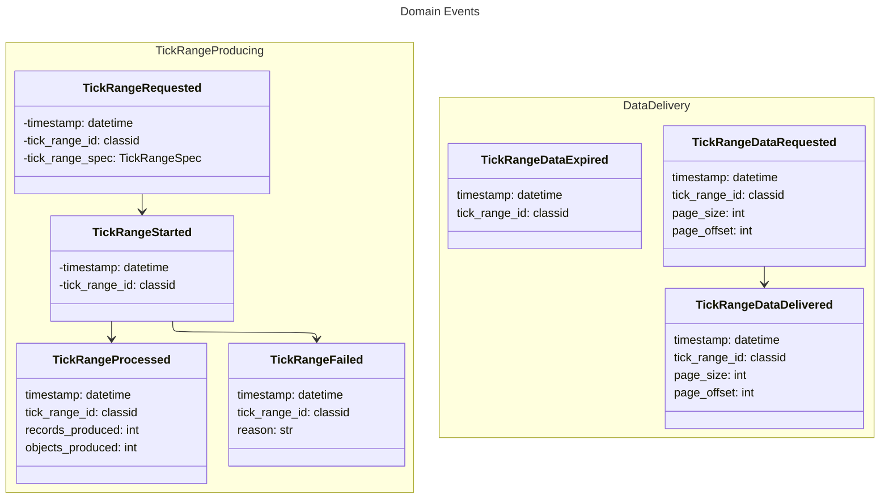
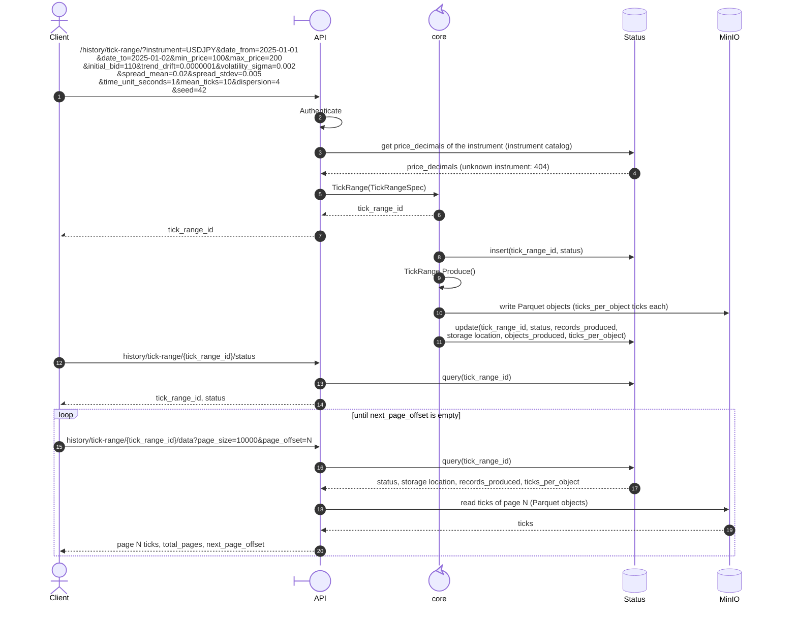

## Domain Analysis

## Scope

This iteration covers the **historic tick range**, requested through the **API**: generate a set of ticks for an instrument, a date range and the parameters of the tick range, and download it.

Out of scope for now:

- OHLC: its concepts, its scenarios and the `OHLC Range` of the bounded context.
- The real-time tick feed and OHLC feed, and with them the feed pace.
- The use of the library as a direct consumer (importing it and calling the method). The consumer is the API.

## Domain concepts

- **Tick**: It is defined as a timestamp, a bid and an ask. The difference between ask and bid is called spread.
- **Instrument**: Represents a financial instrument. It is reference data held in an instrument catalog, which is read-only for this context. For now its only properties are the symbol and the number of decimal places of its price (`price_decimals`).
- **OHLC** (out of scope for now): It is an aggregation of ticks during a fixed period of time. Some OHLC aggregations do not use time but ticks or pips (price variation), but those are out of the scope for now. An **OHLC** entity is defined by **timeframe** and the **instrument** the prices represent, and is represented by the **Open**, **High**, **Low**, **Close** prices  the **Volume** of ticks for the period.
- **Timeframe** (out of scope for now): Represents the time period that tick data is grouped in: an OHLC period. For example m5 (five minutes), H1 (one hour) and so on.
- **Trend**: Defines the drift of the arithmetic random walk that produces the tick prices: the expected price change per second, in price units. If the drift is zero, the process is a pure random walk. If it is positive the trend leans upward, and if it is negative the trend leans downward.
- **Volatility**: Determines the magnitude of the random price changes. It is the standard deviation of the price change over one second, in price units per square-root second.
- **Spread**: The difference between the ask and the bid of a tick. It is sampled for each tick from a normal distribution defined by a mean and a standard deviation, in price units; a sampled value below zero is set to zero.
- **Tick timing**: Defines when the ticks of a tick range happen. The time is split in time units of a fixed length. For each time unit a random number of ticks is drawn from a negative binomial distribution, defined by its mean and its dispersion (optionally limited to a minimum and a maximum), and the ticks are placed at random moments inside the time unit.
- **Date range**: Is the period a price dataset must cover. It is defined by a start date and an end date.
- **OHLC range** (out of scope for now): Is a set of OHLC aggregations that follows a strict regular time sequence order. Is driven by a *price range*, *volatility* and *trend*.
- **Tick range**: Is a set of ticks, that follows an irregular time sequence order. Is driven by a *price range*, a *volatility*, a *trend*, a *spread* and a *tick timing*.
- **Random walk**: Underlying process producing tick price. The theory and the models per asset class are described in [Synthetic Price Generation with Random Walks](synthetic-price-generation.md).
- **Feed pace** (out of scope for now): The speed at which a price feed is generated: realtime (1x), twice the speed (2x) and so on.
- **Price Range**: Is defined by a minimum and maximum price values, that constraints a Tick or an OHLC ranges.

## Domain Scenarios

### Get historic tick price

I need to generate an **historic data set** of **tick** price for an **instrument**, for a **date range**, with an **initial bid**, a **price range**, a **trend**, a **volatility**, a **spread**, a **tick timing** and, optionally, a **seed** to repeat the same data. The consumers for this historic price dataset can be an API or a program that imports the library and executes the method to get the historic file. In this iteration the consumer is the API; the library is out of scope for now.

### Get historic OHLC price (out of scope for now)

I need to generate an **historic data set** of **OHLC** price for an **instrument**, for a **timeframe**, a **date range**, a **price range**, a **trend** and a **volatility**. The consumers for this historic price dataset can be an API or a program that imports the library and executes the method to get the historic file.

### Get tick feed (out of scope for now)

For my algorithmic trading infrastructure, I need to receive a realtime **tick** price feed, for an **instrument**, with an **initial bid**, a **price range**, a **trend**, a **volatility**, a **spread** and a **tick timing**. Eventually I must be able to change the price range, the volatility and the trend. Each time a tick is produced I need to receive an event that carries as payload the tick attributes. Eventually I need to be able to receive the price feed at realtime, meaning at the pace the ticks are produced, or I can speed up the time pace so I can simulate, for example, one hour of tick data in just 1 minute.

Also I need to change at any time the parameters that determine how the tick data is generated: **price range**, **trend**, **volatility**, along with **price feed pace**.

### Get OHLC feed (out of scope for now)

For my algorithmic trading infrastructure, I need to receive a realtime **OHLC** price feed, for an **instrument**, a **timeframe**, a **price range**, a **trend** and a **volatility**. Eventually I must be able to change the price range, the volatility and the trend. Each time an OHLC period is produced I need to receive an event that carries as payload the OHLC attributes. Eventually I need to be able to receive the price feed at realtime, meaning at the pace the ticks are produced, or I can speed up the time pace so I can simulate, for example, one day of H1 OHLC data in just 1 minute.

Also I need to change at any time the parameters that determine how the tick data is generated: **price range**, **trend**, **volatility**, along with **price feed pace**.

# Bounded Context

## Synthetic Price

This bounded context covers everything related to producing synthetic quotes, either tick or OHLC, whether historic or quote by quote.

```mermaid

---
config:
  theme: default
  look: classic
  layout: elk
---
usecase-beta
  systemBoundary "Synthetic Price Bounded Context"
    TR(Tick Range)
    OHLCR(OHLC Range - out of scope for now)
    RW(Random Walk)

  end

  OHLCR --Is built from--> TR
  TR -- is generated by --> RW
  


```

The instrument catalog is outside this bounded context: it is reference data that the context only reads (see "Aggregate data model"). The domain accesses it through an `InstrumentCatalog` interface, so it does not depend on where the data is stored.

## Aggregates 

### Tick Range



The ticks are not part of the aggregate: `produce()` writes them as records in Parquet objects in MinIO (see "Output timeseries structure") and returns only the counts (`records_produced` and `objects_produced`).

`InstrumentSpec` is a copy of the instrument properties taken from the catalog when the range is requested. The application service reads the catalog and puts the copy in the spec; the aggregate never queries the catalog.

### Domain Events





### Price generation process

How the price of each tick is produced (the random walk, its drift and volatility, and the model chosen per asset class) is specified in [Synthetic Price Generation with Random Walks](synthetic-price-generation.md). That document is the reference for the generator; this document does not repeat it.

- Decided: this implementation uses the **arithmetic random walk** with drift (a biased random walk). Geometric Brownian Motion (GBM) is documented in the reference document and will be explored later. See "Common foundation: random walk, GBM and drift", subsection "Arithmetic random walk".
- In the arithmetic walk, the price change between two ticks is normal, with mean equal to the drift per second times the gap between the ticks, and standard deviation equal to the volatility per square-root second times the square root of the gap. The gap is the time between the two ticks, in seconds. Drift and volatility are in price units, not percentages.
- Decided: `Trend` is the drift of the walk and `Volatility` is its standard deviation, both in price units (drift per second, volatility per square-root second). Each has a single value, `Trend.drift` and `Volatility.sigma`, because the arithmetic walk uses one drift and one volatility.
- Because the arithmetic walk is not bounded (it can drift out of the price range, or below zero), the price range rule in Business Rules, which resets the bid to `initial_bid`, keeps the bid inside the range (and above zero, because `min_price` must be greater than zero). The ask of a reset tick can exceed `max_price`, see Business Rules.
- The reference document also describes how tick timestamps are generated (section "Tick timing", subsection "Random number of ticks per time unit"): a random number of ticks is drawn for each time unit from a probability distribution (Poisson, negative binomial or a fixed number), and the ticks are placed at random positions inside the time unit.
- Decided: the number of ticks per time unit follows a negative binomial distribution, with a mean number of ticks per time unit and a dispersion parameter (Poisson is its limiting case).
- The number of ticks in a date range is random, so `records_produced` is only known after the range is produced; before that only its expected value (mean ticks per time unit times the number of time units) is known.

**Parameters of the generator.** `TickRangeSpec` holds everything needed to generate the ticks with the arithmetic random walk:

| Spec field | Unit | Used for |
| --- | --- | --- |
| `instrument.symbol` | text | Symbol of the instrument. It must exist in the instrument catalog. |
| `instrument.price_decimals` | integer, 0 to 8 | Decimal places of the instrument price, copied from the catalog when the range is requested. Used to round `bid` and `ask` on output. |
| `time_range.date_from` | UTC datetime | Start of the series. The time of a tick is `date_from` plus the seconds elapsed since the start. |
| `time_range.date_to` | UTC datetime | End of the series. Ticks that fall after it are discarded. |
| `initial_bid` | price | Bid at `date_from` (the start of the walk) and the value the bid is reset to. |
| `price_range.min_price`, `price_range.max_price` | price | Limits used by the reset rule. |
| `trend.drift` | price per second | Drift of the walk. |
| `volatility.sigma` | price per square-root second | Standard deviation of the price change over one second. |
| `spread.mean`, `spread.stdev` | price | Normal distribution the spread of each tick is sampled from. |
| `tick_timing.time_unit_seconds` | seconds | Length of the time unit. |
| `tick_timing.mean_ticks` | ticks per time unit | Mean of the number of ticks of a time unit. |
| `tick_timing.dispersion` | number greater than 0 | Dispersion of the negative binomial. The variance of the number of ticks of a time unit is `mean_ticks + mean_ticks² / dispersion`, so the larger the dispersion, the closer the counts are to Poisson (variance equal to the mean). See "Random number of ticks per time unit" in [synthetic-price-generation.md](synthetic-price-generation.md). |
| `tick_timing.min_ticks`, `tick_timing.max_ticks` | ticks, optional | Bounds of the number of ticks of a time unit; a count outside them is redrawn. |
| `seed` | integer | Seed of the random number generator. With the same implementation, the same spec gives the same series. If the client does not send it, the service generates it and stores it with the spec. |

Not part of the spec: the number of ticks per storage object (`ticks_per_object`, a service setting), the market calendar (the series runs continuously, without weekends or holidays) and the tick volume.

**Generation steps.**

1. Split the period from `date_from` to `date_to` in time units of `time_unit_seconds` seconds.
2. For each time unit, draw the number of ticks from the negative binomial distribution with mean `mean_ticks` and dispersion `dispersion` (redrawing it while it is outside `min_ticks` and `max_ticks`, when they are given).
3. Place that number of ticks at random moments inside the time unit and sort them. Put the time units one after another and discard the ticks after `date_to`. The gap of a tick is the time since the previous tick, in seconds; the first gap is measured from `date_from`.
4. Start the walk with the bid equal to `initial_bid` at `date_from`. For each tick, add to the bid a normal random change with mean `trend.drift` times the gap and standard deviation `volatility.sigma` times the square root of the gap.
5. Sample the spread of the tick from the normal distribution with `spread.mean` and `spread.stdev` (setting it to zero if negative), and compute `ask = bid + spread`.
6. Apply the price range rule of Business Rules to the tick: if it is outside the price range, the bid is reset to `initial_bid`, and the walk continues from there.
7. Round `bid` and `ask` to `instrument.price_decimals` decimals (only the written values are rounded, not the state of the walk) and write the ticks in time order, `ticks_per_object` per object, in the structure defined in "Output timeseries structure".

All random numbers come from one generator initialised with `seed`.

**Rounding.** Only the values written to the output are rounded. The state of the walk keeps its full precision, and the price range rule is evaluated on the unrounded values. If the state were rounded at every tick, the walk would hardly move, because the step per tick is much smaller than the last decimal (for example about 0.000005 against 0.001 for a price with 3 decimals). As a consequence, consecutive ticks can have the same bid, and a small sampled spread can become zero after rounding.

### Business Rules

**Tick**

- ask = bid + spread
- spread is sampled for each tick from a normal distribution with the `mean` and `stdev` of the `Spread` of the `TickRangeSpec`. A spread cannot be negative, so a sampled value below zero is set to zero.
- if bid < price_range.min_price or ask > price_range.max_price, then bid = initial_bid (the price is reset, not reflected back into the range) and ask = bid + spread. The spread is random and cannot be known in advance, so the reset tick is exempt from this validation: if `initial_bid + spread` exceeds `price_range.max_price`, the tick is kept as is and the rule is not applied again to it. The rule applies again from the next tick.


**Instrument and request**

- The `instrument` symbol must exist in the instrument catalog. Otherwise the request is rejected (404) and no tick range is created.
- `initial_bid`, `min_price` and `max_price` must not have more decimals than `price_decimals` of the instrument. Otherwise the request is rejected (400).

## Generic Sequence Scenario


Based on the Asynchronous Request-Reply (Submit → Poll → Download) pattern.





## Constraints


### Domain event storage


Domain events are stored on the same database where the aggregates are stored.

Events are append-only: they are never updated or deleted by the domain. A single table holds all event types (`TickRangeRequested`, `TickRangeStarted`, `TickRangeProcessed`, `TickRangeFailed`, `TickRangeDataRequested`, `TickRangeDataDelivered`, `TickRangeDataExpired`). Attributes common to every event are first-class columns; event-specific attributes (e.g. `tick_range_spec`, `records_produced`, `objects_produced`, `page_size`, `page_offset`) go in the `payload` JSON column.

Design notes:

- `aggregate_id` is the `tick_range_id`; `aggregate_version` is a per-aggregate sequence that gives a strict order of the lifecycle events (`TickRangeRequested`, `TickRangeStarted`, `TickRangeProcessed`, `TickRangeFailed`, `TickRangeDataExpired`) and, through the unique constraint, optimistic concurrency control.
- The download events (`TickRangeDataRequested` and `TickRangeDataDelivered`) are outside the version sequence: their `aggregate_version` is `NULL`. They do not change the state of the aggregate, and this way concurrent downloads of the same range cannot conflict on the unique constraint. They are ordered by `recorded_at`.
- `event_id` is a globally unique identifier, which allows consumers to deduplicate (idempotency).
- `recorded_at` is when the event was persisted.
- `published_at` supports the transactional outbox pattern: the event is written in the same transaction as the aggregate state, and a relay publishes pending events (`published_at IS NULL`) later.
- `correlation_id` / `causation_id` allow tracing a flow (e.g. Requested → Started → Processed) end to end.

```sql
CREATE TABLE domain_event (
    -- Identity
    event_id           UUID          NOT NULL,
    event_type         VARCHAR(100)  NOT NULL,   -- e.g. 'TickRangeRequested'

    -- Aggregate the event belongs to
    aggregate_type     VARCHAR(100)  NOT NULL,   -- e.g. 'TickRange'
    aggregate_id       UUID          NOT NULL,   -- tick_range_id
    aggregate_version  INTEGER       NULL,       -- sequence of the lifecycle events of the aggregate, starts at 1;
                                                 -- NULL for download events (no version)

    -- Time
    recorded_at        TIMESTAMPTZ   NOT NULL DEFAULT now(),  -- when it was persisted

    -- Event data
    payload            JSONB         NOT NULL,   -- event-specific attributes
    metadata           JSONB         NOT NULL DEFAULT '{}'::jsonb,  -- e.g. user, source

    -- Tracing
    correlation_id     UUID          NULL,       -- groups all events of one flow
    causation_id       UUID          NULL,       -- event_id of the event that caused this one

    -- Publication (transactional outbox)
    published_at       TIMESTAMPTZ   NULL,       -- NULL = pending publication

    CONSTRAINT pk_domain_event PRIMARY KEY (event_id),
    CONSTRAINT uq_domain_event_aggregate_version
        UNIQUE (aggregate_type, aggregate_id, aggregate_version),
    CONSTRAINT ck_domain_event_aggregate_version CHECK (aggregate_version IS NULL OR aggregate_version > 0),
    -- download events have no version; every other event has one
    CONSTRAINT ck_domain_event_version_required
        CHECK ((event_type IN ('TickRangeDataRequested', 'TickRangeDataDelivered'))
               = (aggregate_version IS NULL))
);

-- Replay the lifecycle history of one aggregate
CREATE INDEX ix_domain_event_aggregate
    ON domain_event (aggregate_id, aggregate_version);

-- List all the events of one aggregate in time order (includes the download events)
CREATE INDEX ix_domain_event_aggregate_time
    ON domain_event (aggregate_id, recorded_at);

-- Query by event type over time
CREATE INDEX ix_domain_event_type_recorded
    ON domain_event (event_type, recorded_at);

-- Outbox relay: find events not yet published
CREATE INDEX ix_domain_event_pending
    ON domain_event (recorded_at)
    WHERE published_at IS NULL;

-- Trace a flow
CREATE INDEX ix_domain_event_correlation
    ON domain_event (correlation_id)
    WHERE correlation_id IS NOT NULL;
```

Example row for `TickRangeProcessed`:

```sql
INSERT INTO domain_event
    (event_id, event_type, aggregate_type, aggregate_id, aggregate_version,
     payload, correlation_id)
VALUES
    (gen_random_uuid(), 'TickRangeProcessed', 'TickRange',
     '5b0f3c1e-9d7a-4c55-8a53-0d6d2f1c7e11', 3,
     '{"records_produced": 864000, "objects_produced": 9}',
     '5b0f3c1e-9d7a-4c55-8a53-0d6d2f1c7e11');
```

The database engine is PostgreSQL. The DDL relies on `UUID`, `JSONB`, `TIMESTAMPTZ` and partial indexes, and the example uses `gen_random_uuid()`, which is built in from PostgreSQL 13 (earlier versions need the `pgcrypto` extension).


### Aggregate data model

Only the `TickRange` aggregate exists so far, so the schema covers it. The generated ticks are not stored in the database: they are written to MinIO (S3-compatible object storage) as Parquet objects. The database holds the `tick_range` table and the read-only `instrument` reference table:

- `tick_range`: the aggregate root, with the `TickRangeSpec` value objects (`PriceRange`, `TimeRange`, `Trend`, `Volatility`, `Spread`, `TickTiming`) flattened into columns, because value objects have no identity of their own. It also holds the processing status that the API reads when the client polls `/status`, and the location of the tick data in MinIO.
- `instrument`: the instrument catalog, which is reference data and read-only for the Synthetic Price context. For each symbol it holds the decimal places of its price (`price_decimals`). The database is the source of truth: the table is filled by an import job (from a file or a public data source) and not by this context. It is read when a tick range is requested.

Design notes:

- `tick_range_id` is generated by the domain (UUID) so it can be returned to the client before anything is persisted, as in the sequence diagram.
- `version` is incremented on every update of the root and is aligned with the `domain_event.aggregate_version` of the latest lifecycle event, which gives optimistic concurrency. The download events have no version and do not change the row. The aggregate row and its new lifecycle events are written in the same transaction.
- `status` is a projection of the latest event: `REQUESTED` → `STARTED` → `PROCESSED` → `EXPIRED`, or `STARTED` → `FAILED` when the production fails (the reason is kept in `failure_reason`). The events remain the source of truth for history.
- Prices use `NUMERIC`, never floating point, because the domain defines them as `Decimal`. The `Trend`, `Volatility`, `Spread` and `TickTiming` parameters are statistical and use `DOUBLE PRECISION` (the optional bounds of the tick count are integers). Trend, volatility and spread are in price units.
- Tick data lives in MinIO as Parquet files, called storage objects, under `<storage_prefix>part-<n>.parquet` (for example `tick-range/5b0f3c1e-.../part-000001.parquet`). The format is always Parquet, so it is not stored. `storage_bucket` and `storage_prefix` locate the objects, and `objects_produced` tells how many exist. Each object holds `ticks_per_object` ticks (the last one holds the remainder). This is a storage setting chosen by the service when the range is produced; it is independent of the page size that clients ask for. No page table is needed.
- Parquet row groups are written with 10,000 rows, so the API can read part of an object (for a page smaller than the object) without loading all of it.
- The consumer downloads the data through an API endpoint, one page per request (for example `GET history/tick-range/{tick_range_id}/data?page_size=S&page_offset=N`). MinIO is internal: the API reads the ticks from the Parquet objects and returns them, so the consumer needs no access to MinIO and no link is stored.
- `page_size` is chosen by the client, with a maximum of 100,000 ticks per page, equal to the initial `ticks_per_object` (a larger value, or a value below 1, is rejected with a 400 error). Default: 10,000. `page_offset` is the zero-based page number for that `page_size`, so page `N` holds the ticks in positions `N × page_size` to `(N + 1) × page_size − 1`. The client must keep the same `page_size` for all requests of one download, because changing it changes which ticks a given `page_offset` refers to.
- The API maps the tick positions to storage objects: object `floor(position / ticks_per_object)`, and the row group inside it. A page can span two objects when `page_size` does not divide `ticks_per_object`; the API then reads from both and joins the result. `ticks_per_object` must be a multiple of 10,000 so that the default page size never spans objects. With `page_size` equal to `ticks_per_object` (100,000 initially), page `N` is exactly object `N`, which is the cheapest read: one object, no slicing. While `ticks_per_object` is not smaller than the maximum page size, a page spans at most two objects.
- The response carries `records_produced` and the total number of pages for the requested `page_size` (`ceil(records_produced / page_size)`), so the consumer knows when to stop, and the `next_page_offset`, which is empty on the last page. A `page_offset` outside that range returns 404. A range in `REQUESTED`, `STARTED` or `FAILED` returns 409 (the response carries the status, and the `failure_reason` when it is `FAILED`). A range in `EXPIRED`, or whose `expires_at` has passed, returns 410.
- Retention and expiry: the retention period is a configuration value, in whole days. The objects of a tick range expire through a MinIO lifecycle rule (TTL) with that period, so the application does not delete them. `expires_at` is set to the time the range becomes `PROCESSED` plus the retention period. MinIO applies the TTL by object age, in whole days and when its lifecycle scan runs, so the objects can disappear a little before or after `expires_at`; the API treats a range as expired (410) once `expires_at` has passed, or when its objects are missing. A periodic job marks the `PROCESSED` ranges whose `expires_at` has passed as `EXPIRED` and emits `TickRangeDataExpired`. The `tick_range` row and its events are kept.
- Writing to MinIO and to the database cannot be one transaction. Write the objects first and then, in one database transaction, mark the range `PROCESSED` and insert `TickRangeProcessed`. If the process fails in between, the result is orphan objects, which the MinIO TTL removes after the retention period, like any other object. It is never a `PROCESSED` range without data.
- The ticks (columns `timestamp`, `bid` and `ask`) are not stored in the database. Their columns and types are defined in "Output timeseries structure" below. Ticks are written in time order, and each object holds a fixed number of ticks except the last one.
- `tick_range.price_decimals` is a copy of the `price_decimals` of the instrument taken when the range is requested. It makes a range reproducible with the same seed even if the catalog changes later, and it travels in the `TickRangeRequested` event inside the spec. `tick_range.instrument` references `instrument.symbol`.

```sql
CREATE TABLE instrument (
    symbol          VARCHAR(20)  NOT NULL,
    price_decimals  SMALLINT     NOT NULL,   -- decimal places of the price

    CONSTRAINT pk_instrument PRIMARY KEY (symbol),
    CONSTRAINT ck_instrument_price_decimals CHECK (price_decimals BETWEEN 0 AND 8)
);

CREATE TYPE tick_range_status AS ENUM
    ('REQUESTED', 'STARTED', 'PROCESSED', 'EXPIRED', 'FAILED');

CREATE TABLE tick_range (
    tick_range_id      UUID               NOT NULL,
    version            INTEGER            NOT NULL DEFAULT 1,
    status             tick_range_status  NOT NULL DEFAULT 'REQUESTED',

    -- TickRangeSpec
    instrument         VARCHAR(20)        NOT NULL,   -- e.g. 'USDJPY'
    price_decimals     SMALLINT           NOT NULL,   -- copy of instrument.price_decimals when requested
    initial_bid        NUMERIC(18,8)      NOT NULL,

    -- PriceRange
    min_price          NUMERIC(18,8)      NOT NULL,
    max_price          NUMERIC(18,8)      NOT NULL,

    -- TimeRange
    date_from          TIMESTAMPTZ        NOT NULL,
    date_to            TIMESTAMPTZ        NOT NULL,

    -- Trend (price units per second)
    trend_drift        DOUBLE PRECISION   NOT NULL,

    -- Volatility (price units per square-root second)
    volatility_sigma   DOUBLE PRECISION   NOT NULL,

    -- Spread (price units)
    spread_mean        DOUBLE PRECISION   NOT NULL,
    spread_stdev       DOUBLE PRECISION   NOT NULL,

    -- TickTiming
    time_unit_seconds  DOUBLE PRECISION   NOT NULL,   -- length of the time unit
    mean_ticks         DOUBLE PRECISION   NOT NULL,   -- mean number of ticks per time unit
    dispersion         DOUBLE PRECISION   NOT NULL,   -- negative binomial dispersion
    min_ticks          INTEGER            NULL,       -- optional lower bound of ticks per time unit
    max_ticks          INTEGER            NULL,       -- optional upper bound of ticks per time unit

    -- Random number generator
    seed               BIGINT             NOT NULL,   -- generated by the service if the client sends none

    -- Result of producing (filled when PROCESSED)
    records_produced   BIGINT             NULL,
    expires_at         TIMESTAMPTZ        NULL,       -- time of PROCESSED + retention period (configuration)

    -- Failure (filled when FAILED)
    failure_reason     TEXT               NULL,

    -- Location of the tick data in MinIO (filled when PROCESSED)
    storage_bucket     VARCHAR(63)        NULL,       -- S3 bucket names: 3 to 63 chars
    storage_prefix     VARCHAR(1024)      NULL,       -- e.g. 'tick-range/<tick_range_id>/'
    objects_produced   INTEGER            NULL,       -- number of Parquet objects under the prefix
    ticks_per_object   INTEGER            NULL,       -- ticks in each object except the last

    created_at         TIMESTAMPTZ        NOT NULL DEFAULT now(),
    updated_at         TIMESTAMPTZ        NOT NULL DEFAULT now(),

    CONSTRAINT pk_tick_range PRIMARY KEY (tick_range_id),
    CONSTRAINT fk_tick_range_instrument   FOREIGN KEY (instrument) REFERENCES instrument (symbol),
    CONSTRAINT ck_tick_range_price_decimals CHECK (price_decimals BETWEEN 0 AND 8),
    CONSTRAINT ck_tick_range_version      CHECK (version > 0),
    CONSTRAINT ck_tick_range_price_range  CHECK (min_price < max_price),
    CONSTRAINT ck_tick_range_min_price    CHECK (min_price > 0),
    CONSTRAINT ck_tick_range_initial_bid  CHECK (initial_bid BETWEEN min_price AND max_price),
    CONSTRAINT ck_tick_range_time_range   CHECK (date_from < date_to),
    CONSTRAINT ck_tick_range_volatility   CHECK (volatility_sigma >= 0),
    CONSTRAINT ck_tick_range_spread       CHECK (spread_mean >= 0 AND spread_stdev >= 0),
    CONSTRAINT ck_tick_range_tick_timing  CHECK (
        time_unit_seconds > 0 AND mean_ticks > 0 AND dispersion > 0
        AND (min_ticks IS NULL OR min_ticks >= 0)
        AND (max_ticks IS NULL OR max_ticks >= 1)
        AND (min_ticks IS NULL OR max_ticks IS NULL OR min_ticks <= max_ticks)
    ),
    CONSTRAINT ck_tick_range_ticks_per_object CHECK (ticks_per_object IS NULL OR ticks_per_object > 0),
    CONSTRAINT ck_tick_range_failure      CHECK (status <> 'FAILED' OR failure_reason IS NOT NULL),
    CONSTRAINT ck_tick_range_storage      CHECK (
        status NOT IN ('PROCESSED', 'EXPIRED')
        OR (storage_bucket IS NOT NULL AND storage_prefix IS NOT NULL
            AND records_produced IS NOT NULL AND objects_produced IS NOT NULL
            AND ticks_per_object IS NOT NULL)
    )
);

-- Expiry job: find PROCESSED ranges whose retention period has passed
CREATE INDEX ix_tick_range_expiry
    ON tick_range (expires_at)
    WHERE status = 'PROCESSED';
```

Decisions and open points:

- **Where the ticks live (decided).** In MinIO, not in the database. The aggregate in the database holds only the metadata and the pointer to the objects.
- **Data format (decided).** Parquet. The format is always Parquet, so the table has no format column. If another format is ever needed, add a column with a default of `'parquet'`.
- **Download (decided).** Through an API endpoint with pagination by `page_size` and `page_offset`, as originally planned.
- **Page size (decided).** Chosen by the client, maximum 100,000 ticks per page, matching the initial `ticks_per_object`. A `page_size` above the maximum (or below 1) is rejected with a 400 error. Both values are configuration and can be tuned independently; if `ticks_per_object` is lowered below the maximum page size, a page may span more than two objects.
- **Objects size (decided, to be tuned).** `ticks_per_object` starts at 100,000 and will be fine-tuned along the way. It is a configuration value and must be a multiple of 10,000. Larger objects mean fewer files in MinIO, smaller ones mean less data to write per file. Because each range stores its own `ticks_per_object`, changing the configuration only affects new ranges; existing ones are still read correctly.
- **Event page semantics (decided).** The `page_offset` in `TickRangeDataRequested` and `TickRangeDataDelivered` is only meaningful together with the `page_size` used, so both should be in the event payload. `TickRangeProcessed` reports `records_produced` and `objects_produced`, not a number of pages, since the number of pages depends on the client's page size.
- **Delivery events volume (decided).** Only the first request and the last delivery of a download are recorded, not every page, so the number of events per download is constant however many pages a client reads.
  - `TickRangeDataRequested` is recorded when a request arrives with `page_offset = 0`.
  - `TickRangeDataDelivered` is recorded when the response sent has an empty `next_page_offset`, meaning the last page was delivered.
  - Both rules depend only on the current request, so the API does not need to look up earlier events or keep state between pages.
  - Consequences: a client that stops midway produces a `TickRangeDataRequested` without a matching `TickRangeDataDelivered`, and a client that starts at an offset other than 0 produces no `TickRangeDataRequested`. Each full download of the same range produces its own pair of events.
  - Concurrency (decided): the download events are recorded outside the aggregate's version sequence (`aggregate_version` is `NULL`), so they never increment `version` and concurrent downloads of the same range cannot conflict with each other or with the lifecycle events. The unique constraint ignores `NULL` versions, and `ck_domain_event_version_required` makes sure that only the download events are unversioned.
- **Aggregate loading (decided).** The repository loads only the `tick_range` root. Tick data is read from MinIO page by page through a separate reader, never as part of the aggregate.
- **Scope (decided).** This iteration covers the historic tick range through the API. OHLC, the real-time feeds and the library as a direct consumer are out of scope for now (see "Scope").
- **Failure (decided).** A production that fails moves the range to `FAILED`, with the reason in `failure_reason` and a `TickRangeFailed` event. `/status` returns the status and the reason, and `/data` returns 409.
- **Retention and expiry (decided).** The retention period is configuration; MinIO deletes the objects with a lifecycle rule (TTL) of that length. `expires_at` is the time the range becomes `PROCESSED` plus the retention period. A periodic job marks expired ranges `EXPIRED` and emits `TickRangeDataExpired`.
- **Prices (decided).** `min_price` must be greater than zero, so the bid never goes below zero.
- **Instrument (decided).** The instrument is reference data from a separate, read-only instrument catalog. The database is the source of truth, loaded by an import job. For now it has only the symbol and `price_decimals`. The tick range keeps a copy of `price_decimals` in its spec, and `bid` and `ask` are rounded to it on output only; the state of the walk is not rounded.
- **Generation parameters (decided).** `TickRangeSpec` holds all the parameters needed to generate the ticks with the arithmetic random walk (see "Price generation process"): trend drift, volatility sigma, spread mean and standard deviation, tick timing (time unit, mean ticks, dispersion, optional bounds) and a seed. `date_to` is required, because a series needs an end.
- **OHLC (out of scope for now).** `OHLCRange` is not modelled as an aggregate, and this data model covers only `TickRange`.

### Output timeseries structure

The ticks of a tick range are stored in MinIO as Parquet objects (`part-<n>.parquet`, see "Aggregate data model"). Every object of a tick range has the structure below. Rows are ordered by `timestamp` (non-decreasing), and the objects follow each other in time order, so the position of a tick in the series is the order of its object and its row inside it.

| Column | Parquet type | Nullable | Note |
| --- | --- | --- | --- |
| timestamp | TIMESTAMP, UTC, microsecond unit | no | Tick time, produced by the tick-timing process (a random number of ticks per time unit, placed at random inside it; see `synthetic-price-generation.md`, "Random number of ticks per time unit"). |
| bid | DECIMAL(18,8) | no | Bid price, produced by the random walk. |
| ask | DECIMAL(18,8) | no | Ask price. Ask - Bid (the spread) is >= 0. |

Notes:

- The spread is not stored. It is `ask - bid`, always >= 0 (a sampled spread below zero is set to zero, see Business Rules), so it can be computed when reading.
- The random walk works with floating point numbers. `bid` and `ask` are rounded to the `price_decimals` of the instrument (0 to 8) before they are written; only the written values are rounded. The column type stays `DECIMAL(18,8)` for every instrument, the same precision as the prices in the `tick_range` table, so the file schema does not depend on the instrument.
- The timestamp is stored in UTC with microsecond resolution. At a high tick rate two ticks can fall on the same microsecond, which is why the order is non-decreasing and not strictly increasing.


