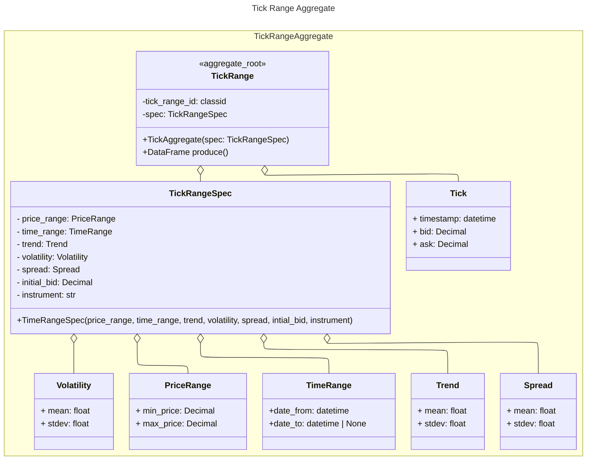
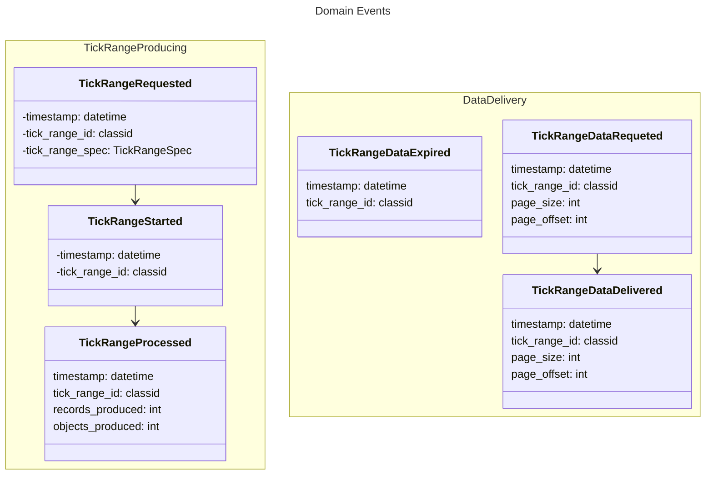
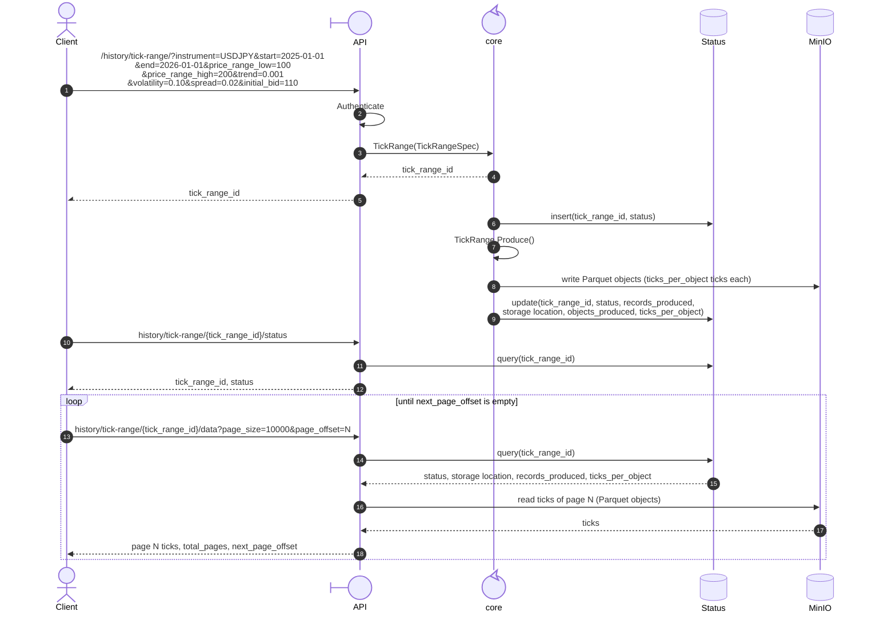

## Domain Analysis

## Domain concepts

- **Tick**: It is defined as a timestamp, a bid and an ask. The difference between ask and bid is called spread.
- **Instrument**: Represents a financial instrument and its properties.
- **OHLC**: It is an aggregation of ticks during a fixed period of time. Some OHLC aggregations do not use time but ticks or pips (price variation), but those are out of the scope for now. An **OHLC** entity is defined by **timeframe** and the **instrument** the prices represent, and is represented by the **Open**, **High**, **Low**, **Close** prices  the **Volume** of ticks for the period.
- **Timeframe**:  Represents the time period that tick data is grouped in: an OHLC period. For example m5 (five minutes), H1 (one hour) and so on.
- **Trend Regime**: Defines the drift from the puerly random walk price generation process. Is defind by a mean and a standard deviation. If the mean is zero, the process is  a pure rando walk. If the mean is positive the trend is lean upward or if the mean is negative, the tredn is leaned downward.
- **Volatility**: Determines the magnitude of the range values. It is defined by a mean and a standard deviation.
- **Spread**: The difference between the ask and the bid of a tick. In a price range it is defined by a mean and a standard deviation, and it is sampled for each tick.
- **Date range**: Is the period a price dataset must cover. It is defined by a start date and an end date.
- **OHLC range**: Is a set of OHLC aggregations that follows a strict regular time sequence order. Is driven by a *price range*, *volatility* and *trend*.
- **Tick range**: Is a set of ticks, that follows an irregular time sequence order. Is driven by *price range*, a *volatility* and a *trend*.
- **Random walk**: Underlying process producing tick price. The theory and the models per asset class are described in [Synthetic Price Generation with Random Walks](synthetic-price-generation.md).
- **Feed pace**: The speed at which a price feed is generated: realtime (1x), twice the speed (2x) and so on.
- **Price Range**: Is defined by a minimum and maximum price values, that constraints a Tick or an OHLC ranges.

## Domain Scenarios

### Get historic tick price

I need to generate an **historic data set** of **tick** price for an **instrument**, for a **date range**, **price range**,  **trend regime** and a **volatility regimes**. The consumers for this historic price dataset can be an API or a program that imports the library and executes the method to get the historic file.

### Get historic OHLC price

I need to generate an **historic data set** of **OHLC** price for an **instrument**, for a **timeframe**, a **date range**, a **price range**, a **trend regime** and a **volatility regime**. The consumers for this historic price dataset can be an API or a program that imports the library and executes the method to get the historic file.

### Get tick feed

For my algorithmic trading infrastructure, I need to receive a realtime **tick** price feed, for an **instrument**, a **price range**, a **trend regime** and a **volatility regime**. Eventually I must be able to change the price range, the volatility and trend regimes. Each time a tick is produced I need to receive an event that carries as payload the tick attributes. Eventually I need to be able to receive the price feed at realtime, meaning at the pace the ticks are produced, or I can speed up the time pace so I can simulate, for example, one hour of tick data in just 1 minute.

Also I need to change at any time the parameters that determine how the tick data is generated: **price range**, **trend regime**, **volatility regime**, along with **price feed pace**.

### Get OHLC feed

For my algorithmic trading infrastructure, I need to receive a realtime **OHLC** price feed, for an **instrument**, a **timeframe**, a **price range**, a **trend regime** and a **volatility regime**. Eventually I must be able to change the price range, the volatility and trend regimes. Each time an OHLC period is produced I need to receive an event that carries as payload the OHLC attributes. Eventually I need to be able to receive the price feed at realtime, meaning at the pace the ticks are produced, or I can speed up the time pace so I can simulate, for example, one day of H1 OHLC data in just 1 minute.

Also I need to change at any time the parameters that determine how the tick data is generated: **price range**, **trend regime**, **volatility regime**, along with **price feed pace**.

# Bounded Context

## Synthetic Price

This bounded context covers everything related to producing synthetic quotes, either tick or OHLC, whether historic or quote by quote.

```mermaid

---
config:
  theme: default
  look: classic
  layout: elk
---
usecase-beta
  systemBoundary "Synthetic Price Bounded Context"
    TR(Tick Range)
    OHLCR(OHLC Range)
    RW(Random Walk)

  end

  OHLCR --Is built from--> TR
  TR -- is generated by --> RW
  


```

## Aggregates 

### Tick Range



### ThDomain Events





### Price generation process

How the price of each tick is produced (the random walk, its drift and volatility, and the model chosen per asset class) is specified in [Synthetic Price Generation with Random Walks](synthetic-price-generation.md). That document is the reference for the generator; this document does not repeat it.

- The generator is a random walk on log prices (discretised Geometric Brownian Motion), with a drift term that makes it a biased random walk. See "Common foundation: random walk, GBM and drift" and, for currency pairs such as the `USDJPY` example, the "Forex" section.
- `Trend` is the drift (the bias) and `Volatility` is the size of the random step. The exact mapping from their `mean` and `stdev` to the parameters of the model in the reference document is still to be defined.
- The reference document covers the price step only. It does not define how tick timestamps are generated (the arrival process) or how many ticks fall in a date range. That is still open and needed to know `records_produced` in advance.

### Business Rules

**Tick**

- ask = bid + spread
- spread is sampled for each tick from the `Spread` distribution of the `TickRangeSpec` (`mean`, `stdev`). A spread cannot be negative, so a sampled value below zero is set to zero.
- if bid < price_range.min_price or ask > price_range.max_price, then bid = initial_bid (the price is reset, not reflected back into the range) and ask = bid + spread. The spread is random and cannot be known in advance, so the reset tick is exempt from this validation: if `initial_bid + spread` exceeds `price_range.max_price`, the tick is kept as is and the rule is not applied again to it. The rule applies again from the next tick.


## Generic Sequence Scenario


Based on the Asynchronous Request-Reply (Submit → Poll → Download) pattern.





## Constraints


### Domain event storage


Domain events are stored on the same database where the aggregates are stored.

Events are append-only: they are never updated or deleted by the domain. A single table holds all event types (`TickRangeRequested`, `TickRangeStarted`, `TickRangeProcessed`, `TickRangeDataRequested`, `TickRangeDataDelivered`, `TickRangeDataExpired`). Attributes common to every event are first-class columns; event-specific attributes (e.g. `tick_range_spec`, `records_produced`, `objects_produced`, `page_size`, `page_offset`) go in the `payload` JSON column.

Design notes:

- `aggregate_id` is the `tick_range_id`; `aggregate_version` is a per-aggregate sequence that gives a strict order of events and, through the unique constraint, optimistic concurrency control.
- `event_id` is a globally unique identifier, which allows consumers to deduplicate (idempotency).
- `recorded_at` is when the event was persisted.
- `published_at` supports the transactional outbox pattern: the event is written in the same transaction as the aggregate state, and a relay publishes pending events (`published_at IS NULL`) later.
- `correlation_id` / `causation_id` allow tracing a flow (e.g. Requested → Started → Processed) end to end.

```sql
CREATE TABLE domain_event (
    -- Identity
    event_id           UUID          NOT NULL,
    event_type         VARCHAR(100)  NOT NULL,   -- e.g. 'TickRangeRequested'

    -- Aggregate the event belongs to
    aggregate_type     VARCHAR(100)  NOT NULL,   -- e.g. 'TickRange'
    aggregate_id       UUID          NOT NULL,   -- tick_range_id
    aggregate_version  INTEGER       NOT NULL,   -- sequence within the aggregate, starts at 1

    -- Time
    recorded_at        TIMESTAMPTZ   NOT NULL DEFAULT now(),  -- when it was persisted

    -- Event data
    payload            JSONB         NOT NULL,   -- event-specific attributes
    metadata           JSONB         NOT NULL DEFAULT '{}'::jsonb,  -- e.g. user, source

    -- Tracing
    correlation_id     UUID          NULL,       -- groups all events of one flow
    causation_id       UUID          NULL,       -- event_id of the event that caused this one

    -- Publication (transactional outbox)
    published_at       TIMESTAMPTZ   NULL,       -- NULL = pending publication

    CONSTRAINT pk_domain_event PRIMARY KEY (event_id),
    CONSTRAINT uq_domain_event_aggregate_version
        UNIQUE (aggregate_type, aggregate_id, aggregate_version),
    CONSTRAINT ck_domain_event_aggregate_version CHECK (aggregate_version > 0)
);

-- Replay the history of one aggregate
CREATE INDEX ix_domain_event_aggregate
    ON domain_event (aggregate_id, aggregate_version);

-- Query by event type over time
CREATE INDEX ix_domain_event_type_occurred
    ON domain_event (event_type, recorded_at);

-- Outbox relay: find events not yet published
CREATE INDEX ix_domain_event_pending
    ON domain_event (recorded_at)
    WHERE published_at IS NULL;

-- Trace a flow
CREATE INDEX ix_domain_event_correlation
    ON domain_event (correlation_id)
    WHERE correlation_id IS NOT NULL;
```

Example row for `TickRangeProcessed`:

```sql
INSERT INTO domain_event
    (event_id, event_type, aggregate_type, aggregate_id, aggregate_version,
     payload, correlation_id)
VALUES
    (gen_random_uuid(), 'TickRangeProcessed', 'TickRange',
     '5b0f3c1e-9d7a-4c55-8a53-0d6d2f1c7e11', 3,
     '{"records_produced": 1250000, "objects_produced": 13}',
     '5b0f3c1e-9d7a-4c55-8a53-0d6d2f1c7e11');
```

The database engine is PostgreSQL. The DDL relies on `UUID`, `JSONB`, `TIMESTAMPTZ` and partial indexes, and the example uses `gen_random_uuid()`, which is built in from PostgreSQL 13 (earlier versions need the `pgcrypto` extension).


### Aggregate data model

Only the `TickRange` aggregate exists so far, so the schema covers it. The generated ticks are not stored in the database: they are written to MinIO (S3-compatible object storage) as Parquet objects. The database holds a single table:

- `tick_range`: the aggregate root, with the `TickRangeSpec` value objects (`PriceRange`, `TimeRange`, `Trend`, `Volatility`, `Spread`) flattened into columns, because value objects have no identity of their own. It also holds the processing status that the API reads when the client polls `/status`, and the location of the tick data in MinIO.

Design notes:

- `tick_range_id` is generated by the domain (UUID) so it can be returned to the client before anything is persisted, as in the sequence diagram.
- `version` is incremented on every update of the root and is aligned with `domain_event.aggregate_version`, which gives optimistic concurrency. The aggregate row and its new events are written in the same transaction.
- `status` is a projection of the latest event: `REQUESTED` → `STARTED` → `PROCESSED` → `EXPIRED`. The events remain the source of truth for history.
- Prices use `NUMERIC`, never floating point, because the domain defines them as `Decimal`. The `Trend`, `Volatility` and `Spread` parameters are statistical and use `DOUBLE PRECISION`.
- Tick data lives in MinIO as Parquet files, called storage objects, under `<storage_prefix>part-<n>.parquet` (for example `tick-range/5b0f3c1e-.../part-000001.parquet`). The format is always Parquet, so it is not stored. `storage_bucket` and `storage_prefix` locate the objects, and `objects_produced` tells how many exist. Each object holds `ticks_per_object` ticks (the last one holds the remainder). This is a storage setting chosen by the service when the range is produced; it is independent of the page size that clients ask for. No page table is needed.
- Parquet row groups are written with 10,000 rows, so the API can read part of an object (for a page smaller than the object) without loading all of it.
- The consumer downloads the data through an API endpoint, one page per request (for example `GET history/tick-range/{tick_range_id}/data?page_size=S&page_offset=N`). MinIO is internal: the API reads the ticks from the Parquet objects and returns them, so the consumer needs no access to MinIO and no link is stored.
- `page_size` is chosen by the client, with a maximum of 100,000 ticks per page, equal to the initial `ticks_per_object` (a larger value is rejected with 400 or clamped to 100,000; choose one and document it). Default: 10,000. `page_offset` is the zero-based page number for that `page_size`, so page `N` holds the ticks in positions `N × page_size` to `(N + 1) × page_size − 1`. The client must keep the same `page_size` for all requests of one download, because changing it changes which ticks a given `page_offset` refers to.
- The API maps the tick positions to storage objects: object `floor(position / ticks_per_object)`, and the row group inside it. A page can span two objects when `page_size` does not divide `ticks_per_object`; the API then reads from both and joins the result. `ticks_per_object` should be a multiple of 10,000 so that the default page size never spans objects. With `page_size` equal to `ticks_per_object` (100,000 initially), page `N` is exactly object `N`, which is the cheapest read: one object, no slicing. While `ticks_per_object` is not smaller than the maximum page size, a page spans at most two objects.
- The response carries `records_produced` and the total number of pages for the requested `page_size` (`ceil(records_produced / page_size)`), so the consumer knows when to stop, and the `next` offset, which is empty on the last page. A `page_offset` outside that range returns 404, and a range that is not `PROCESSED` returns 409 (not ready) or 410 (`EXPIRED`).
- Expiry (`TickRangeDataExpired`) deletes the objects under the prefix and sets `status = 'EXPIRED'`. The `tick_range` row and its events are kept. A MinIO lifecycle rule on the prefix can act as a safety net, but the application should remain the one that emits the event.
- Writing to MinIO and to the database cannot be one transaction. Write the pages first and then, in one database transaction, mark the range `PROCESSED` and insert `TickRangeProcessed`. If the process fails in between, the result is orphan objects, which a cleanup job can remove by finding prefixes whose range is not `PROCESSED`. It is never a `PROCESSED` range without data.
- `ask` is not stored in the database. Each Parquet page file carries the columns `timestamp` (timestamp, UTC), `bid` and `ask` (decimal, same precision as the domain `Decimal`), following the `Tick` definition. Ticks are written in time order, and each object holds a fixed number of ticks except the last one.

```sql
CREATE TYPE tick_range_status AS ENUM
    ('REQUESTED', 'STARTED', 'PROCESSED', 'EXPIRED');

CREATE TABLE tick_range (
    tick_range_id      UUID               NOT NULL,
    version            INTEGER            NOT NULL DEFAULT 1,
    status             tick_range_status  NOT NULL DEFAULT 'REQUESTED',

    -- TickRangeSpec
    instrument         VARCHAR(20)        NOT NULL,   -- e.g. 'USDJPY'
    initial_bid        NUMERIC(18,8)      NOT NULL,

    -- PriceRange
    price_min          NUMERIC(18,8)      NOT NULL,
    price_max          NUMERIC(18,8)      NOT NULL,

    -- TimeRange
    date_from          TIMESTAMPTZ        NOT NULL,
    date_to            TIMESTAMPTZ        NULL,       -- NULL = open ended

    -- Trend
    trend_mean         DOUBLE PRECISION   NOT NULL,
    trend_stdev        DOUBLE PRECISION   NOT NULL,

    -- Volatility
    volatility_mean    DOUBLE PRECISION   NOT NULL,
    volatility_stdev   DOUBLE PRECISION   NOT NULL,

    -- Spread
    spread_mean        DOUBLE PRECISION   NOT NULL,
    spread_stdev       DOUBLE PRECISION   NOT NULL,

    -- Result of producing (filled when PROCESSED)
    records_produced   BIGINT             NULL,
    expires_at         TIMESTAMPTZ        NULL,

    -- Location of the tick data in MinIO (filled when PROCESSED)
    storage_bucket     VARCHAR(63)        NULL,       -- S3 bucket names: 3 to 63 chars
    storage_prefix     VARCHAR(1024)      NULL,       -- e.g. 'tick-range/<tick_range_id>/'
    objects_produced   INTEGER            NULL,       -- number of Parquet objects under the prefix
    ticks_per_object   INTEGER            NULL,       -- ticks in each object except the last

    created_at         TIMESTAMPTZ        NOT NULL DEFAULT now(),
    updated_at         TIMESTAMPTZ        NOT NULL DEFAULT now(),

    CONSTRAINT pk_tick_range PRIMARY KEY (tick_range_id),
    CONSTRAINT ck_tick_range_version      CHECK (version > 0),
    CONSTRAINT ck_tick_range_price_range  CHECK (price_min < price_max),
    CONSTRAINT ck_tick_range_initial_bid  CHECK (initial_bid BETWEEN price_min AND price_max),
    CONSTRAINT ck_tick_range_time_range   CHECK (date_to IS NULL OR date_from < date_to),
    CONSTRAINT ck_tick_range_stdev        CHECK (trend_stdev >= 0 AND volatility_stdev >= 0
                                                 AND spread_stdev >= 0),
    CONSTRAINT ck_tick_range_spread_mean  CHECK (spread_mean >= 0),
    CONSTRAINT ck_tick_range_ticks_per_object CHECK (ticks_per_object IS NULL OR ticks_per_object > 0),
    CONSTRAINT ck_tick_range_storage      CHECK (
        status NOT IN ('PROCESSED', 'EXPIRED')
        OR (storage_bucket IS NOT NULL AND storage_prefix IS NOT NULL
            AND records_produced IS NOT NULL AND objects_produced IS NOT NULL
            AND ticks_per_object IS NOT NULL)
    )
);

-- Cleanup job: find ranges whose data has expired
CREATE INDEX ix_tick_range_expiry
    ON tick_range (expires_at)
    WHERE status = 'PROCESSED';
```

Decisions and open points:

- **Where the ticks live (decided).** In MinIO, not in the database. The aggregate in the database holds only the metadata and the pointer to the objects.
- **Data format (decided).** Parquet. The `data_format` column was removed because the format is fixed. If another format is ever needed, add the column back with a default of `'parquet'`.
- **Download (decided).** Through an API endpoint with pagination by `page_size` and `page_offset`, as originally planned.
- **Page size (decided).** Chosen by the client, maximum 100,000 ticks per page, matching the initial `ticks_per_object`. Both values are configuration and can be tuned independently; if `ticks_per_object` is lowered below the maximum page size, a page may span more than two objects.
- **Objects size (decided, to be tuned).** `ticks_per_object` starts at 100,000 and will be fine-tuned along the way. It is a configuration value and must be a multiple of 10,000. Larger objects mean fewer files in MinIO, smaller ones mean less data to write per file. Because each range stores its own `ticks_per_object`, changing the configuration only affects new ranges; existing ones are still read correctly.
- **Event page semantics (decided).** The `page_offset` in `TickRangeDataRequested` and `TickRangeDataDelivered` is only meaningful together with the `page_size` used, so both should be in the event payload. `TickRangeProcessed` now reports `records_produced` and `objects_produced` instead of `pages_produced`, since the number of pages depends on the client's page size.
- **Delivery events volume (decided).** Only the first request and the last delivery of a download are recorded, not every page, so the number of events per download is constant however many pages a client reads.
  - `TickRangeDataRequested` is recorded when a request arrives with `page_offset = 0`.
  - `TickRangeDataDelivered` is recorded when the response sent has an empty `next_page_offset`, meaning the last page was delivered.
  - Both rules depend only on the current request, so the API does not need to look up earlier events or keep state between pages.
  - Consequences: a client that stops midway produces a `TickRangeDataRequested` without a matching `TickRangeDataDelivered`, and a client that starts at an offset other than 0 produces no `TickRangeDataRequested`. Each full download of the same range produces its own pair of events.
  - Open question: these events are appended to the `tick_range` aggregate, so each one increments its `version`. Concurrent downloads of the same range can then conflict on the optimistic-concurrency check (`uq_domain_event_aggregate_version`) and one must retry the insert. If that matters, retry on conflict, or record download events outside the aggregate's version sequence.
- **Aggregate loading (decided).** The repository loads only the `tick_range` root. Tick data is read from MinIO page by page through a separate reader, never as part of the aggregate.
- **OHLC (out of scope for now).** `OHLCRange` is not modelled as an aggregate, and this data model covers only `TickRange`.


