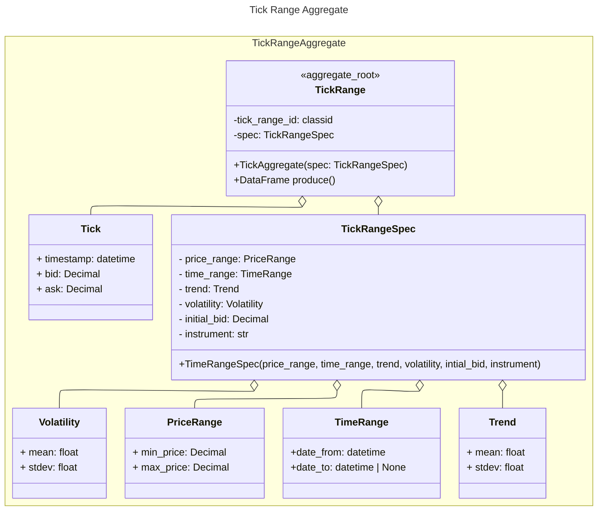
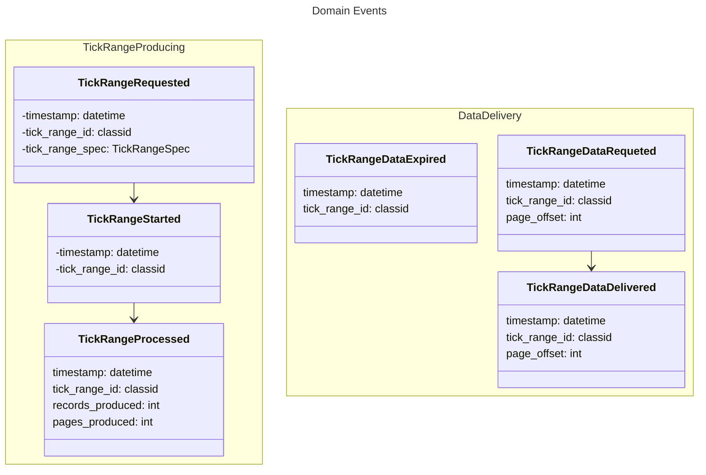
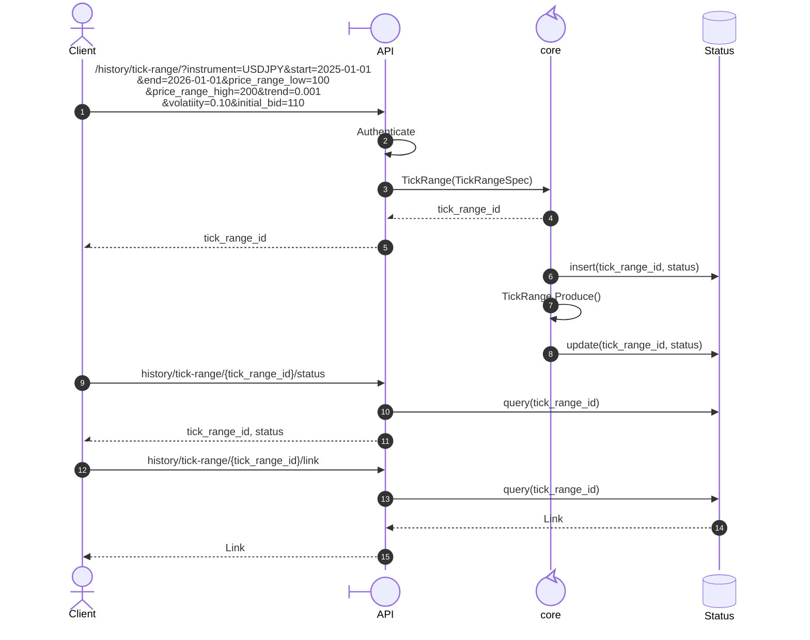

## Domain Analysis

## Domain concepts

- **Tick**: It is defined as a timestamp, a bid, an ask and a volume. The difference between ask and bid is called spread.
- **Instrument**: Represents a financial instrument and its properties.
- **OHLC**: It is an aggregation of ticks during a fixed period of time. Some OHLC aggregations do not use time but ticks or pips (price variation), but those are out of the scope for now. An **OHLC** entity is defined by **timeframe** and the **instrument** the prices represent, and is represented by the **Open**, **High**, **Low**, **Close** prices  the **Volume** of ticks for the period.
- **Timeframe**:  Represents the time period that tick data is grouped in: an OHLC period. For example m5 (five minutes), H1 (one hour) and so on.
- **Trend**: Defines the drift from the puerly random walk price generation process. Is defind by a mean and a variance. If the mean is zero, the process is  a pure rando walk. If the mean is positive the trend is lean upward or if the mean is negative, the tredn is leaned downward.
- **Volatility**: Determines the magnitude of the range values.
- **Trend regime**: It is a sequence of trends, each one lasting a specific number of periods.
- **Date range**: Is the period a price dataset must cover. It is defined by a start date and an end date.
- **OHLC range**: Is a set of OHLC aggregations that follows a strict regular time sequence order. Is driven by a *price range*, *volatility* and *trend*.
- **Tick range**: Is a set of ticks, that follows an irregular time sequence order. Is driven by *price range*, a *volatility* and a *trend*.
- **Random walk**: Underlying process producing tick price.
- **Feed pace**: The speed at which a price feed is generated: realtime (1x), twice the speed (2x) and so on.
- **Price Range**: Is defined by a minimum and maximum price values, that constraints a Tick or an OHLC ranges.
- **Volatility**: Determines the magnitude of the range values.

## Domain Scenarios

### Get historic tick price

I need to generate an **historic data set** of **tick** price for an **instrument**, for a **date range**, **price range**,  **trend regime** and a **volatility regimes**. The consumers for this historic price dataset can be an API or a program that imports the library and executes the method to get the historic file.

### Get historic OHLC price

I need to generate an **historic data set** of **OHLC** price for an **instrument**, for a **timeframe**, a **date range**, a **price range**, a **trend regime** and a **volatility regime**. The consumers for this historic price dataset can be an API or a program that imports the library and executes the method to get the historic file.

### Get tick feed

For my algorithmic trading infrastructure, I need to receive a realtime **tick** price feed, for an **instrument**, a **price range**, a **trend regime** and a **volatility regime**. Eventually I must be able to change the price range, the volatility and trend regimes. Each time a tick is produced I need to receive an event that carries as payload the tick attributes. Eventually I need to be able to receive the price feed at realtime, meaning at the pace the ticks are produced, or I can speed up the time pace so I can simulate, for example, one hour of tick data in just 1 minute.

Also I need to change at any time the parameters that determine how the tick data is generated: **price range**, **trend regime**, **volatility regime**, along with **price feed pace**.

### Get OHLC feed

For my algorithmic trading infrastructure, I need to receive a realtime **OHLC** price feed, for an **instrument**, a **timeframe**, a **price range**, a **trend regime** and a **volatility regime**. Eventually I must be able to change the price range, the volatility and trend regimes. Each time an OHLC period is produced I need to receive an event that carries as payload the OHLC attributes. Eventually I need to be able to receive the price feed at realtime, meaning at the pace the ticks are produced, or I can speed up the time pace so I can simulate, for example, one day of H1 OHLC data in just 1 minute.

Also I need to change at any time the parameters that determine how the tick data is generated: **price range**, **trend regime**, **volatility regime**, along with **price feed pace**.

# Bounded Context

## Synthetic Price

This bounded context covers everything related to producing synthetic quotes, either tick or OHLC, whether historic or quote by quote.

```mermaid

---
config:
  theme: default
  look: classic
  layout: elk
---
usecase-beta
  systemBoundary "Synthetic Price Bounded Context"
    TR(Tick Range)
    OHLCR(OHLC Range)
    RW(Random Walk)

  end

  OHLCR --Is built from--> TR
  TR -- is generated by --> RW
  


```

## Aggregates 

### Tick Range



### Domain Events





### Business Rules

**Tick**

- ask = bid + spread
- if bid < price_rangre.low => bid` = bid + |price_range.low - bid|  
- if ask > price_range.top => bid` = bid - |price_range_top - bid| - spread
- if bid or ask exceeds price_range limits, then bid = initial series price.


## Generic Sequence Scenario


Based on the Asynchronous Request-Reply (Submit → Poll → Download) pattern.





